# Portfolio — Piotr Miros

Frontend / Fullstack Developer (React, TypeScript, Node.js). Od lat lubię łączyć oprogramowanie ze sprzętem: sterowniki, kamery, czujniki.

Kod z tych projektów nie jest publiczny, więc pokazuję **zrzuty ekranu** i opisuję moją rolę. Loga, adresy i nazwy sieci zostały usunięte z obrazów.

- GitHub: [mptr604-boop](https://github.com/mptr604-boop) · [LinkedIn](https://www.linkedin.com/in/piotr-miros)

## Spis

1. [Smart home i wizualizacje SCADA](#1-smart-home-i-wizualizacje-scada)
2. [Sterowanie komorą wentylacyjną](#2-sterowanie-komorą-wentylacyjną)
3. [Kamera drogowa na Raspberry Pi](#3-kamera-drogowa-na-raspberry-pi)
4. [Laboratorium IoT / LIMS (kontrola paliw)](#4-laboratorium-iot--lims-kontrola-paliw)
5. [Generator ogłoszeń z AI (projekt edukacyjny)](#5-generator-ogłoszeń-z-ai-projekt-edukacyjny)
6. [Własne repozytoria](#własne-repozytoria)

---

## 1. Smart home i wizualizacje SCADA

**Problem.** Elektronicy budowali sterowniki na STM32, ale brakowało aplikacji, którą użytkownik obsłuży w domu: światła, ogrzewanie, brama, kamera, harmonogramy.

**Moja rola.** Samodzielnie napisałem system od strony oprogramowania:
- odczyt ramek ze sterownika (USB/RS, CAN, TTL),
- backend (PHP) i baza danych (MySQL),
- skrypty Bash po stronie systemu,
- frontend: panel mobilny, plan domu z temperaturami, schematy SCADA i wykresy,
- panel na pececie z ekranem dotykowym (Ubuntu) i **własna klawiatura ekranowa w JavaScript**, bo systemowe klawiatury nie pasowały do kiosku.

**Technologie:** JavaScript, HTML/CSS, PHP, MySQL, Bash, Linux (Ubuntu), CAN, RS/USB.

**Status.** Przygotowany dla kilku obiektów. Wizualizacja węzła cieplnego działa do dziś.

| | |
|---|---|
| 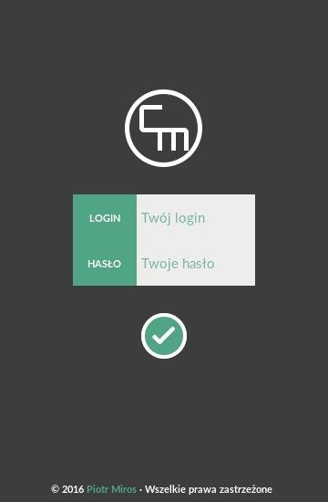 | 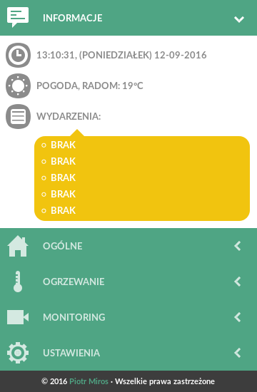 |
| 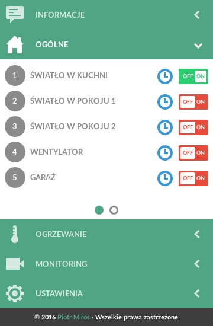 | 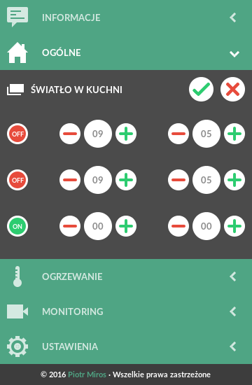 |
| 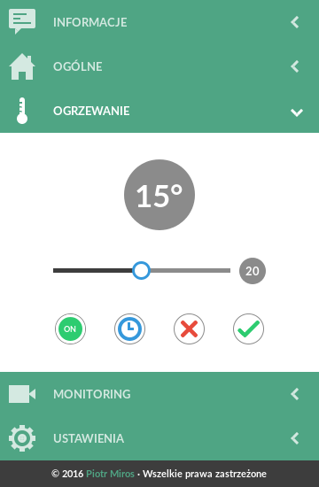 |  |

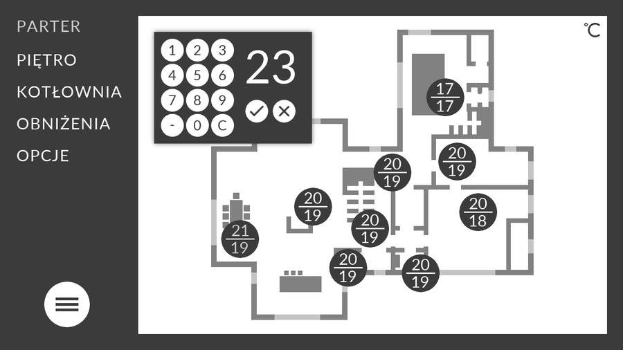

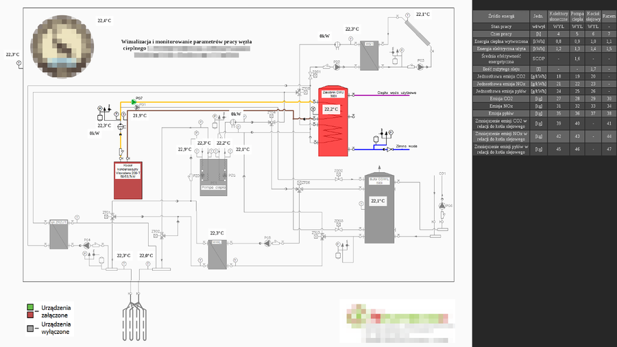

### Nowsza wersja panelu

Druga, nowocześniejsza wersja panelu z klawiaturą ekranową. Powstała **równolegle, jako projekt własny**, na tych samych założeniach: panel sterowania, logowanie, sterowanie wyjściami.

| | |
|---|---|
| 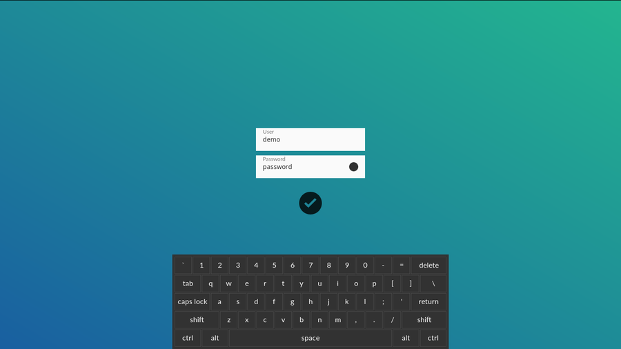 | 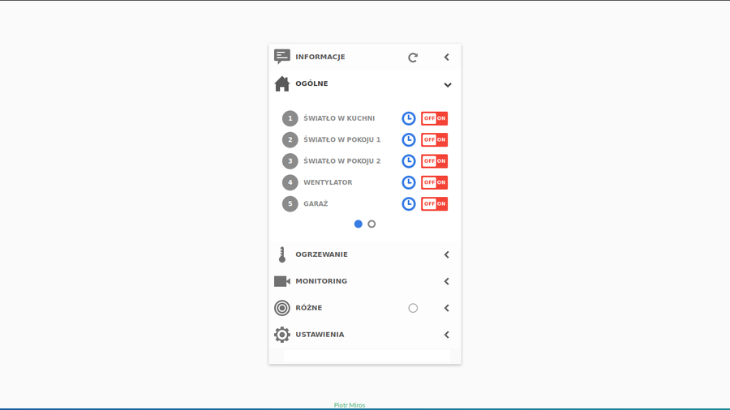 |

---

## 2. Sterowanie komorą wentylacyjną

**Problem.** Podgląd i sterowanie urządzeniami wentylacyjnymi z pomiarami temperatury, wilgotności i ciśnienia oraz automatyka, którą użytkownik może zmieniać bez ingerencji w kod.

**Moja rola.** Aplikacja webowa uruchamiana na tablecie: schemat z animowanym przepływem powietrza, sterowanie wyjściami (pochłaniacz, wentylator, nagrzewnica, czerpnia, wyrzutnia) i wykresy z czujników.

Automatyka jest **programowalna z poziomu interfejsu**: użytkownik edytuje reguły z warunkami (większe/mniejsze niż, temperatura, wilgotność) sterujące przekaźnikami, czyli programuje przepływ powietrza bez zmiany kodu aplikacji. Reguły i konfiguracja są trzymane w pliku (kilkanaście linii), bez bazy danych.

**Technologie:** JavaScript, HTML/CSS, PHP, pliki konfiguracyjne zamiast bazy, Linux, tablet.

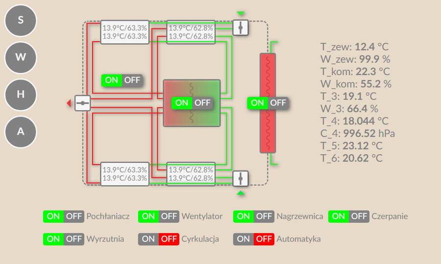

| | |
|---|---|
| 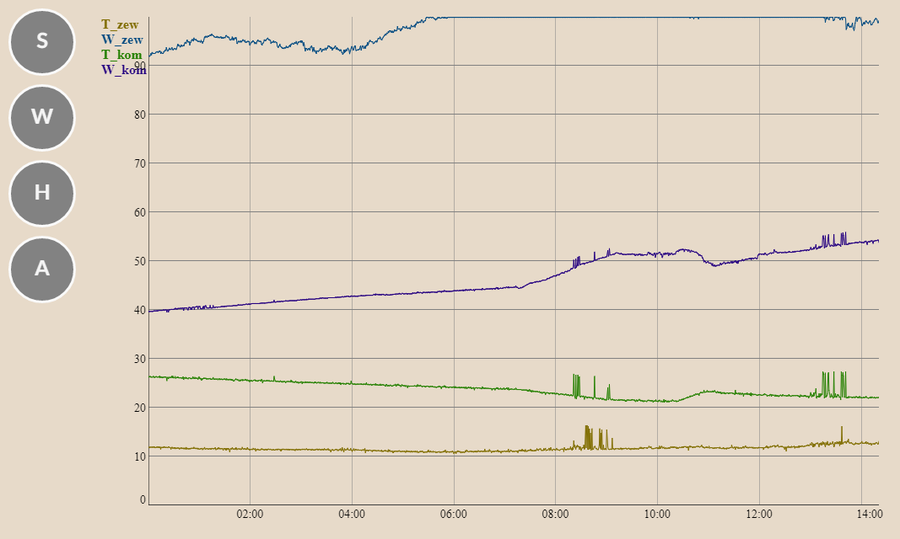 | 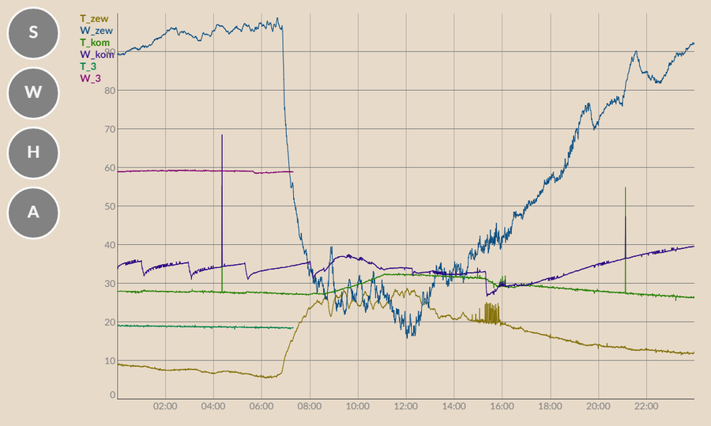 |

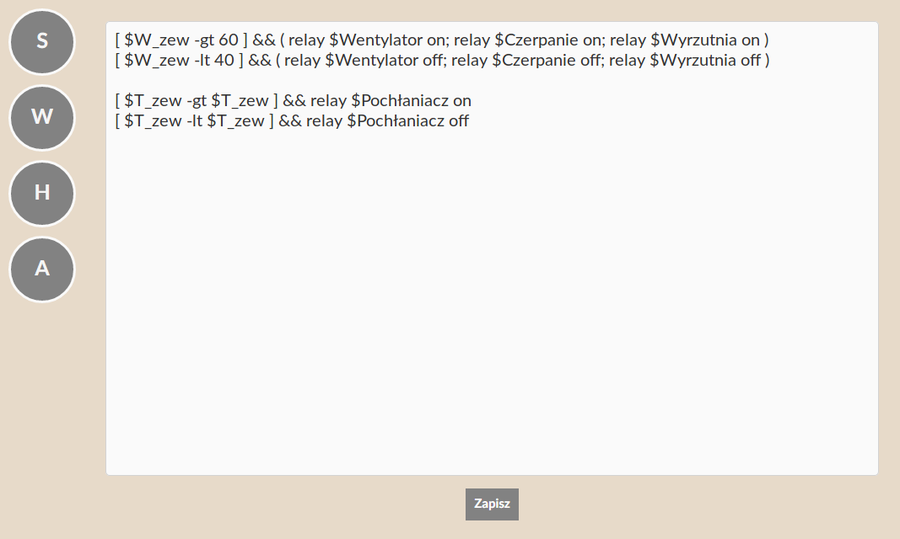

---

## 3. Kamera drogowa na Raspberry Pi

**Problem.** Konfiguracja i obsługa kamer drogowych Dahua w terenie, z telefonu.

**Moja rola.** System na Raspberry Pi:
- backend w Node.js (Express) wysyłający zapytania do kamery i przetwarzający odpowiedzi; dane w SQLite3,
- integracja nie tylko z API kamery, ale też z jej **SDK**, czyli praca z dokumentacją producenta,
- **automatyczne wykrywanie modelu kamery** i dostosowanie API (system działa na dwóch różnych modelach),
- mobilny interfejs webowy: podgląd, harmonogram nagrywania (dzień/noc), oświetlacz IR, karta pamięci,
- interfejs napisany w czystym JavaScripcie, bez frameworka,
- ustawienia kamery i Wi-Fi, PIN, wgrywanie i pobieranie oprogramowania (ZIP).

**Technologie:** Raspberry Pi, Node.js, Express, SQLite3, JavaScript (bez frameworka), HTML/CSS, API i SDK kamer Dahua.

*Logo, adres IP i nazwa sieci zostały usunięte ze zrzutów.*

| | | |
|---|---|---|
| 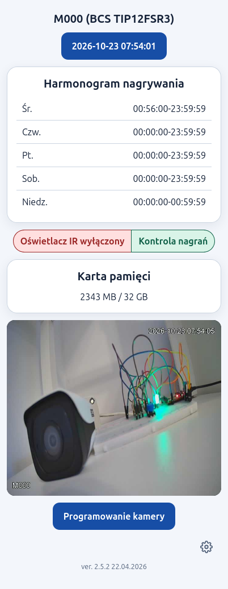 |  | 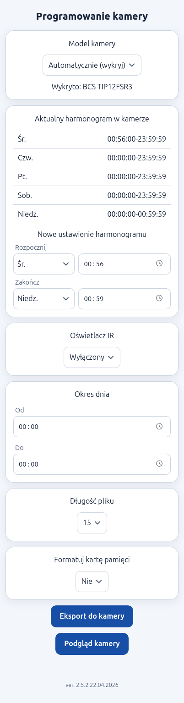 |
| 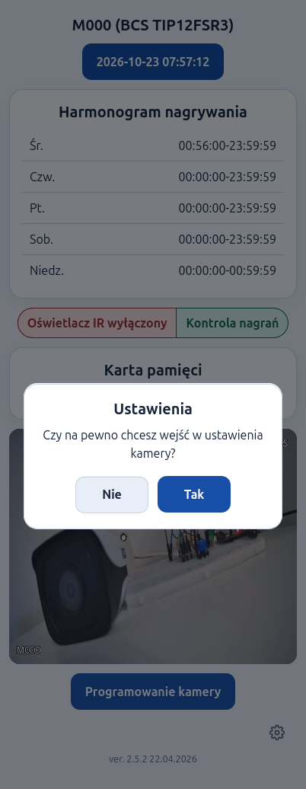 | 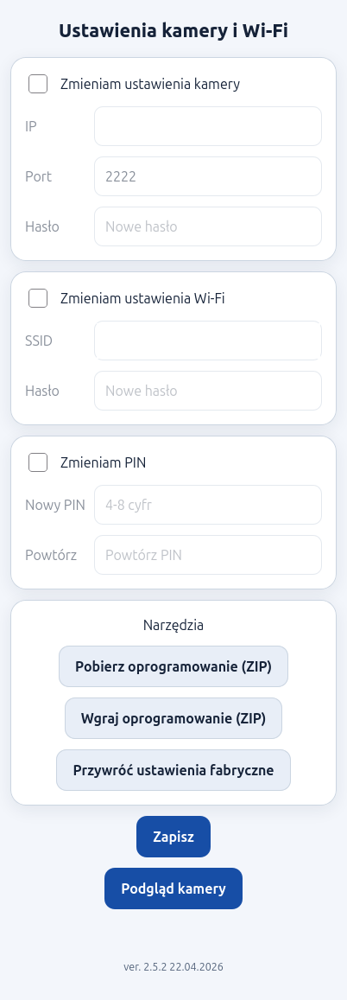 | |

---

## 4. Laboratorium IoT / LIMS (kontrola paliw)

**Problem.** W laboratorium badania jakości paliw (olej napędowy, benzyny) używano precyzyjnych aparatów pomiarowych starszego typu ze złączami szeregowymi (RS-232 / wydruki igłowe). Wyniki były ręcznie spisywane na papierze.

**Moja rola.** Zaprojektowanie i wdrożenie systemu cyfryzacji pomiarów oraz telemetrii:
- odbiór ramek pomiarowych z mikrokontrolerów ESP32 przez niskopoziomowe gniazda **TCP** (port `4000`),
- **czysty Node.js bez zewnętrznych zależności** (`zero-dependencies`) — natywny serwer HTTP i router SSR,
- baza danych **SQLite w przemysłowym trybie WAL** (`node:sqlite` / `DatabaseSync`) z hybrydowym modelem dokumentowym NoSQL (`JSON` w kolumnie `nosql_data`),
- parser RegEx odporny na szumy i błędy transmisji starych maszyn,
- autorski silnik pamięci podręcznej RAM (TTL, unieważnianie wzorcem SQL `LIKE`, Cache Bypass przy awariach),
- natywne JWT z rolami i regułami dostępu (RBAC: usuwanie własnych vs cudzych badań),
- **logi strukturalne (JSON)** z identyfikatorem żądania `request_id` (`AsyncLocalStorage`), maskowaniem sekretów i powodem odrzucenia każdej ramki TCP, żeby łatwiej utrzymywać aplikację,
- **kontrakt danych pomiaru**: jeden plik jest walidatorem na jedynej bramie zapisu (TCP i HTTP) oraz źródłem generowanej dokumentacji dla osób z laboratorium,
- **test wydajności** (`npm run perf`, bez zależności): lokalnie ok. 19 tys. żądań/s dla HTTP i 7,4 tys. ramek/s dla TCP, p95 poniżej 2 ms; to punkt odniesienia, nie obietnica produkcyjna,
- 22 automatyczne testy (`node --test`), Docker i skrypty wdrożeniowe Zero-Downtime z symlinkami oraz rollbackiem.

**Technologie:** Node.js (natywny), SQLite (WAL), TCP sockets, ESP32, JavaScript, HTML/CSS, Docker, Bash, Linux.

**Repozytorium:** [mptr604-boop/laboratorium-iot](https://github.com/mptr604-boop/laboratorium-iot) *(kod publiczny)*

---

## 5. Generator ogłoszeń z AI (projekt edukacyjny)

**Cel.** Poznanie podstaw pracy z modelami AI w praktyce. Potrzebowałem wystawić kilkanaście przedmiotów na Allegro Lokalnie, więc zbudowałem narzędzie, które ze zdjęć i krótkiej notatki robi gotowe ogłoszenie. To projekt do nauki, powstał we współpracy z AI jako asystentem programistycznym, a nie produkt.

**Co zrobiłem:**
- **structured output**: model zwraca obiekt zgodny ze schematem `zod`, a nie luźny tekst,
- **multimodalność**: kilka zdjęć jednego przedmiotu plus notatka w jednej wiadomości (Gemini),
- **ograniczanie halucynacji**: pola `nullable`, lista „do sprawdzenia przez sprzedawcę", prompt zakazujący wymyślania faktów; cenę podaje człowiek, a nie model,
- **testy bez API** (`node --test`) oraz **ewaluacja na prawdziwym modelu** z regułami, np. „marka ma być `null`, gdy jej nie widać",
- **batch**: katalog przedmiotów na wejściu, CSV/JSON na wyjściu, limity zapytań, odporność na błędy, logowanie tokenów.

**Wnioski.** Pierwsza wersja pozwalała modelowi podawać cenę i dostałem wartości „z głowy". Poprawka była w kontrakcie danych i prompcie, a nie w samym modelu.

**Technologie:** TypeScript, Node.js, Vercel AI SDK, Gemini API, zod.

**Repozytorium:** [mptr604-boop/allegro-ai](https://github.com/mptr604-boop/allegro-ai) *(kod publiczny)*

---

## Własne repozytoria

- **[shop](https://github.com/mptr604-boop/shop)** — sklep e-commerce w TypeScript (architektura, CI).
- **[laboratorium-iot](https://github.com/mptr604-boop/laboratorium-iot)** — telemetria i akwizycja danych laboratoryjnych (natywny Node.js, TCP, SQLite WAL, ESP32).
- **[allegro-ai](https://github.com/mptr604-boop/allegro-ai)** — projekt edukacyjny: generator ogłoszeń ze zdjęć (Gemini, structured outputs, ewaluacja, batch).
- **Ubumatic** — skrypt Bash do konfiguracji Ubuntu (GUI Zenity, PL/EN), refaktor i testy. *(link po publikacji repo)*
